# Анализ базы данных Front

Документации нет, поэтому смотрел на названия и проверял каждую связь запросом. Пустые таблицы честно помечены.

## Закупка продукции

Основные — `bm_StorageOperations`, `bm_JournalBarnetDocs`. Связанные — `product`, `vendors`, `bm_JournalTypeDocuments`, `bm_StorageOperationsType`.

`bm_StorageOperations` — строки складских движений.
`ID` — ключ строки, например `5309156`. `DocumentID` — ссылка на документ, например `415422`. `OperationID` — вид движения, `1` = «Поступление». `ProductID` — товар, например `7392`. `VendorID` — поставщик, например `200`. `Count` — количество `3.0000`, `Price` — цена `61.00`, `Amount` — сумма `183.00`.


Пример строк

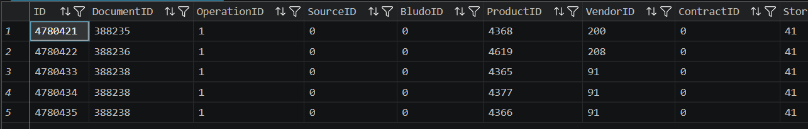


`bm_JournalBarnetDocs` — заголовок документа. `ID` — например `388235`. `DocumentTypeID` — тип, `4` = «Поступление продуктов». `Period` — дата, например `2020-11-11 08:00:00`. `Amount` — сумма документа `892.77`.

Связанные: `product` (4337 «Бананы»), `vendors` (90 «ИП Габур»), `bm_JournalTypeDocuments` (4 = «Поступление продуктов»), `bm_StorageOperationsType` (1 = «Поступление» фактор 1, 2 = «Списание» фактор -1 — отсюда минус в `Count`).

Проверка `VendorID`. Операция «Поступление» бывает и у рецептов, где поставщика нет, поэтому фильтрую по типу документа 4. Выборка пустая — у каждой закупки есть поставщик.

```sql
SELECT so.ID, so.VendorID
FROM bm_StorageOperations so
JOIN bm_JournalBarnetDocs d ON so.DocumentID = d.ID
LEFT JOIN vendors v ON so.VendorID = v.id
WHERE d.DocumentTypeID = 4 AND v.id IS NULL;
```

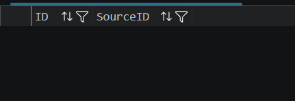

ER-диаграмма
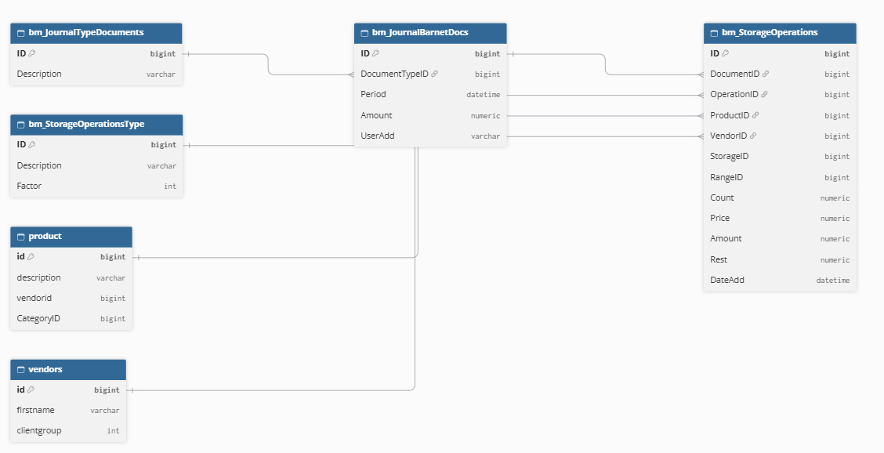

## Продажа товара

Основные — `journal`, `bm_Journal_Details`. Связанные — `transtype`, `product`, `category`, `size`.

`journal` — кассовый журнал, там не только продажи (бывает 301 «Доставка»), поэтому продажи фильтрую по типу.
`transnumber` — ключ строки. `receiptn` — чек, например `14740696`. `transtype` — тип, `101` = продажа. `dater` — `2020-11-11 10:09:39`. `price` — `450.00`, `amount` — `450.00`. `description` — «Пирог Камиль слоеный».

Пример строк

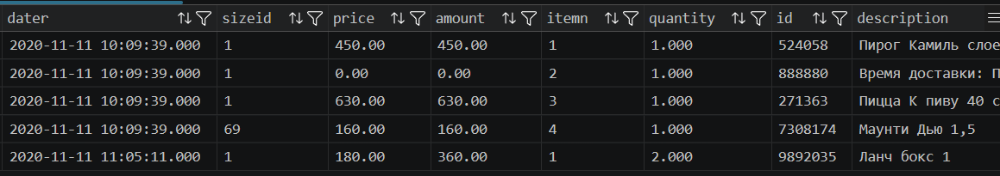

`bm_Journal_Details` — детализация чека: из чего состоит блюдо. `ID` — `11530445`. `SourceID` — ссылка на `journal.transnumber`, `1675591`. `ProductID` — компонент, `4407`. `BludoID` — блюдо, `4451`. `Count` — сколько компонента ушло, `0.4000`.

Связанные: `transtype` (101 «PLU Sales»), `product` (есть `price1`-`price7` — разные цены под разные меню, как в легенде), `category` (147 «Меню доставка», 148 «Меню кафе», `salesflag` — флаг продажи), `size` (3 «Бут.500мл.», база 111 «мл», коэффициент 500).

Проверка `SourceID`. Ищем детали без строки в журнале. Выборка пустая.

```sql
SELECT d.ID, d.SourceID
FROM bm_Journal_Details d
LEFT JOIN journal j ON d.SourceID = j.transnumber
WHERE j.transnumber IS NULL;
```

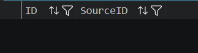

ER-диаграмма
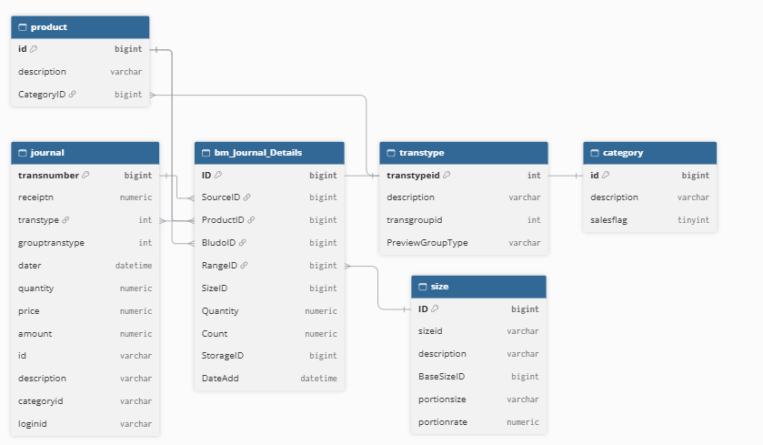

## Взаимоотношения с поставщиками

Основные — `vendors`, `bm_StorageOperations`. Связанные — `vendorgroup`, `bm_JournalBarnetDocs`.

`vendors` — карточки поставщиков. `id` — `90`. `firstname` — «ИП Габур». `clientgroup` — группа, `32`. `INN`, `KPP`, `OGRN` — реквизиты, в примерах NULL, видимо не заполняли.

Пример строк

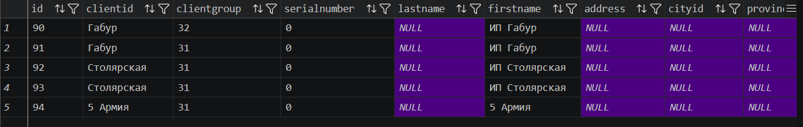


`bm_StorageOperations` — факт поставки: `VendorID` `200`, `DocumentID` `415422`, `Amount` `183.00`.
`vendorgroup` — группы: 31 «Поставщики», 32 «Без названия». У обеих `flag = 0`, что за флаг — не понятно.
`bm_JournalBarnetDocs` — даёт дату поставки через `Period`.
`bm_Contracts` — видимо договоры, таблица пустая.

Проверка `clientgroup`. Ищем поставщиков без группы. Выборка пустая.

```sql
SELECT v.id, v.clientgroup
FROM vendors v
LEFT JOIN vendorgroup vg ON v.clientgroup = vg.vendorgroupid
WHERE vg.vendorgroupid IS NULL;
```

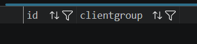

ER-диаграмма
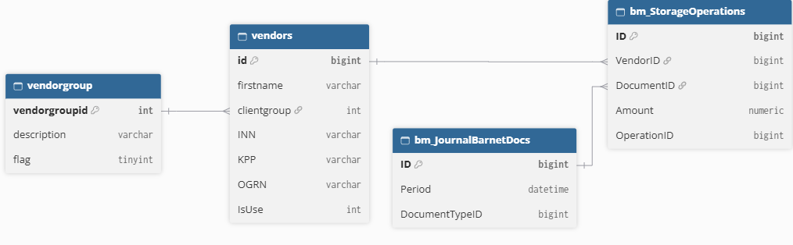

## Работа персонала

Основные — `personnel`, `journal`. Связанная — `transtype`.

`personnel` — карточки сотрудников. `personid` — `897`. `lastname`/`firstname` — «Администратор» / «Barnet», учётка админская.

Пример строк

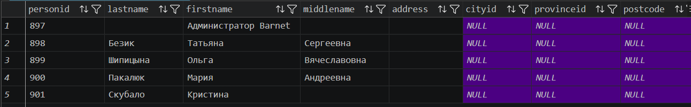


`journal` — начало и конец смены пишутся в тот же журнал. `loginid` — код сотрудника (varchar, а `personid` int, но значения совпадают). `transtype` — `386` начало, `387` окончание. `dater` — время события.
`bm_WorkHours` — судя по названию учёт часов, но `SELECT *` показал пустую таблицу.

Проверка `loginid`. Ищем события смены без сотрудника. Выборка пустая, связь есть, внешнего ключа нет.

```sql
SELECT j.transnumber, j.loginid
FROM journal j
JOIN transtype t ON j.transtype = t.transtypeid
LEFT JOIN personnel p ON j.loginid = p.personid
WHERE t.description IN ('Начало работы', 'Окончание работы')
  AND p.personid IS NULL;
```

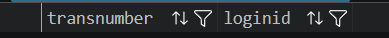

ER-диаграмма
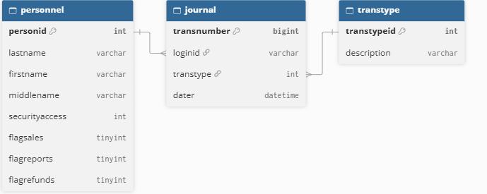

## Остатки

Основная — `bm_StorageOperations`. Связанные — `bm_StorageOperations_Table`, `storages`, `product`, `bm_StorageOperationsType`.

`bm_StorageOperations` — движение товара. `Count` у списаний отрицательный из-за фактора `-1` у операции 2. `Rest` — остаток после операции, в примерах не заполнен.

Пример строк

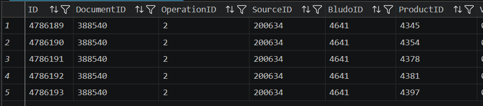


`bm_StorageOperations_Table` — строки документов, например списание ингредиентов под блюдо `4641` (компонент `4345`).


Пример строк

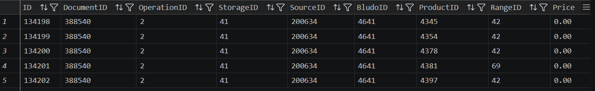


`onhand` — должна хранить остатки, но пустая (проверял `SELECT *`, ноль строк). Значит остаток считаем из движений: сумма `Count` с фактором. Пример строк показать нечем, вместо него скриншот расчёта ниже.
`storages` — склады: `41` «Склад», `ResponsibleID` `897` ссылается на сотрудника.


Пример строк

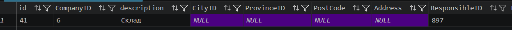


Проверка остатка. Считаю остаток товара `7392` на складе `41`. Запрос возвращает число — движения складываются в остаток.

```sql
SELECT so.ProductID, so.StorageID, SUM(so.Count * t.Factor) AS CurrentStock
FROM bm_StorageOperations so
JOIN bm_StorageOperationsType t ON so.OperationID = t.ID
WHERE so.ProductID = 7392 AND so.StorageID = 41
GROUP BY so.ProductID, so.StorageID;
```

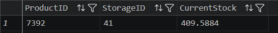

ER-диаграмма
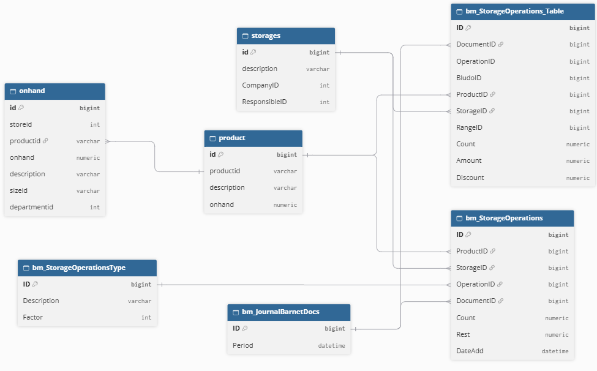